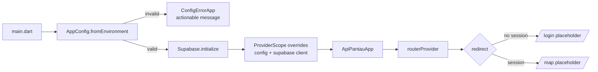

# 0003 — Flutter App Shell & State Conventions

| | |
|---|---|
| Status | Implementing (TL review on branch) |
| Author | MOB-A — Sabil |
| Task | `AP-005` (unblocks `AP-009`, `AP-010`, `AP-020`) |
| Created | 2026-11-07 |
| Reviewers | TL (approver), MOB-B, QA |

## Decisions for the Implementer (TL;DR)

- **D1 — Router is `go_router`.** Declarative routes, one auth redirect, deep links for
  push → incident (`AP-052`). No codegen, no `Navigator` string pushes outside the router.
- **D2 — Riverpod without codegen in M1.** `flutter_riverpod` + manual `Provider` /
  `StreamProvider` / `Notifier`. `riverpod_generator` is deferred until boilerplate actually
  hurts; it would add `build_runner` to every CI run.
- **D3 — One build variant, environment via `--dart-define`.** `APP_ENV` is a label
  (`local|staging|prod`), never inferred from the URL. Android Gradle product flavors are
  deferred to signing (`AP-086`), per DL-0001 Q6.
- **D4 — Config is validated once at bootstrap.** Missing/blank `SUPABASE_URL` or
  `SUPABASE_ANON_KEY` shows a configuration-error screen; it must not crash or silently run
  against the wrong backend.
- **D5 — `Result<T>` for commands, `AsyncValue<T>` for reads.** Repositories catch Supabase
  exceptions and map them to `AppFailure`; no SDK exception reaches a widget.
- **D6 — Feature-first layout with an enforced import rule.** `core` may import `features`
  only in `core/router` (the composition root); features never import another feature.
- **D7 — Theme is provisional until DL-0005.** Material 3 + one seed color + 48 dp targets;
  QA replaces token values in one file. Do not invent brand typography or a second palette.
- **Out of scope:** OTP/identity (`AP-010`, DL-0006), map tiles (`AP-009`), drift/offline
  (`AP-022`), FCM (`AP-011`), CI workflow (AP-007), final visual design (DL-0005).

## Background

`AP-005` is the M1 shell every mobile feature lands on (`docs/BACKLOG.md:75`). The kickoff
assigns MOB-A to design routing, Riverpod, theme, config injection, folder layout, and the
error screen before generating code (`docs/KICKOFF-M1.md:60`). DL-0001 already fixes the
monorepo, stack, package id, and environment mechanism (`design-log/0001-project-foundation.md:13`),
but it deliberately does not choose a router, state boundaries, or a config contract.

No `apps/mobile` tree exists yet, so this log is the only place those conventions can be
defined once instead of being reconstructed by MOB-A, MOB-B, and QA in parallel.

## Problem

Three seats will add screens to the same app in M1–M3. Without an agreed shell they will:

- mix navigation styles (deep link from a push notification breaks),
- re-read `String.fromEnvironment` in random files and ship a build with a blank URL,
- let PostgREST exceptions leak into widgets, producing Indonesian-less red screens,
- create feature-to-feature imports that make the offline queue impossible to test.

The problem is solved when `flutter run` with valid defines lands on a login placeholder,
a rebuild without defines shows an actionable error, and a widget test proves the auth
redirect without touching Supabase.

## Prior Art / Adjacent Mechanisms

| Mechanism | Where | Solves / constrains? |
|---|---|---|
| Monorepo layout, package id, env matrix | `design-log/0001-project-foundation.md:110` | Fixed: `apps/mobile`, `id.clubcoding.apipantau`, `--dart-define` only (D3) |
| Stack lock (Riverpod, Supabase, `flutter_map`) | `design-log/0001-project-foundation.md:15` | Fixed: this log must not add a competing state or backend library |
| UX flows & design tokens | `design-log/index.md:27` (DL-0005, not written) | Constrains theme: no final tokens yet, hence D7 |
| Auth & role model | `design-log/index.md:28` (DL-0006, not written) | Constrains auth: shell only sets the redirect seam; OTP UI is `AP-010` |
| Data model & RLS | `design-log/0002-data-model-and-rls.md` | Constrains `data/`: profile bootstrap is a trigger, client does not create rows |
| PRD stack and NFRs | `docs/PRD-ApiPantau.md:322`, `:263` | Fixes libs, APK ≤ 40 MB, 14 sp text, 48 dp targets, Android 8+ |
| Flutter SDK templates | `flutter create --empty` | Reused for scaffold; counter demo removed |

**Null hypothesis:** could we start coding from `flutter create` and decide conventions as
we go? No. `AP-010` (auth redirect), `AP-009` (map tab), `AP-022` (offline queue) all consume
this shell; changing the router or config contract after three features exist costs a
rewrite. This log closes exactly those seams and nothing product-facing.

## Questions and Answers

**Q1 — `go_router`, raw `Navigator` 2.0, or `auto_route`?**
A1 — `go_router`. It is maintained by the Flutter team, supports one declarative `redirect`
for auth, and exposes URL-style paths for FCM deep links (`/incident/:id`, `AP-052`) without
a code generator. Raw `Navigator` 2.0 needs hand-written page stacks; `auto_route` adds
`build_runner` for no M1 benefit.

**Q2 — Riverpod with code generation?**
A2 — No in M1. The shell needs ~6 providers; manual declarations are readable and keep CI
to `pub get` + `analyze` + `test`. Revisit if `AP-022`/`AP-030` produce provider boilerplate
that obscures intent; that is a new log line, not a silent switch.

**Q3 — Android product flavors vs `--dart-define`?**
A3 — `--dart-define` only. DL-0001 Q6 already selected it (`design-log/0001-project-foundation.md:88`),
and one build variant means one APK path, one CI command, and no `google-services.json`
per-flavor problem before `AP-011`. Flavors are a signing concern (`AP-086`).

**Q4 — How do failures cross layers?**
A4 — Two shapes, deliberately different: reads expose `AsyncValue<T>` (Riverpod owns
loading/error/data); commands and repository writes return `Result<T>` (`Ok`/`Err`) with a
sealed `AppFailure`. Repositories translate `AuthException`, `PostgrestException`,
`SocketException`, and `TimeoutException` at the boundary. Widgets switch on locale-ready
`failure.message`, not on exception types.

**Q5 — Who may import what?**
A5 — `features/*` → `core`, `data`, own subtree only. `data` → `core` only. `core` → `data`
only through providers in `data/`; the single exception is `core/router`, which imports
feature pages as the composition root. Violations are caught in review and by the grep check
in Verification Criteria.

**Q6 — How do we theme before DL-0005 exists?**
A6 — Build `AppTheme.light()` / `AppTheme.dark()` from `ColorScheme.fromSeed` and a
provisional `AppTokens` file. Set the non-negotiables now: text ≥ 14 sp, tap targets ≥ 48 dp,
Material 3, `ThemeMode.system`. QA owns the token values and may change colors/type without
touching widgets (`docs/PRD-ApiPantau.md:275`).

**Q7 — ARB/localization now or later?**
A7 — Later. Ship Indonesian strings in one `AppStrings` class plus `flutter_localizations`
delegates and `supportedLocales: [id, en]`. A second language was not requested; migrating a
single const class to ARB is mechanical. This avoids a generator step before the demo.

**Q8 — When is Supabase initialized?**
A8 — Once in `main()`, after config resolution. The client is injected with a
`ProviderScope` override; `supabaseClientProvider` throws by default so no test can
accidentally require a live backend. `ApiPantauApp` stays a pure widget driven by providers.

**Q9 — Minimum Android version?**
A9 — `minSdk 26` (Android 8.0) to match the release target and field devices
(`docs/PRD-ApiPantau.md:271`). Compile/target SDK follow the current Flutter stable
(3.44 at writing). iOS stays buildable with Flutter defaults but is not a release gate
(DL-0001 D3).

**Q10 — What is the app label?**
A10 — Display name `ApiPantau`, bundle `id.clubcoding.apipantau` (DL-0001 D7). No rename
before the pitch freeze (`docs/BACKLOG.md:264`).

## Design

### Boot and dependency flow



### Folder layout (`apps/mobile`)

```
apps/mobile/
├─ lib/
│  ├─ main.dart                     # config → Supabase.initialize → runApp
│  ├─ app.dart                      # MaterialApp.router; no I/O
│  ├─ core/
│  │  ├─ config/app_config.dart     # AppEnv, AppConfig.fromEnvironment, ConfigException
│  │  ├─ router/app_router.dart     # routes + auth redirect (only core→features import)
│  │  ├─ theme/app_theme.dart       # M3 light/dark from tokens
│  │  ├─ theme/app_tokens.dart      # provisional values; QA owns (DL-0005)
│  │  ├─ l10n/app_strings.dart      # Indonesian copy, const
│  │  ├─ result/result.dart         # sealed Result<T>
│  │  ├─ result/app_failure.dart    # sealed AppFailure + Indonesian messages
│  │  └─ widgets/app_error_view.dart
│  ├─ data/
│  │  └─ supabase/supabase_providers.dart
│  └─ features/
│     ├─ auth/presentation/login_page.dart      # placeholder until AP-010
│     ├─ map/presentation/map_page.dart         # placeholder until AP-009
│     ├─ report/presentation/report_page.dart   # placeholder until AP-020
│     ├─ alerts/presentation/alerts_page.dart
│     ├─ verify/presentation/verify_page.dart
│     └─ profile/presentation/profile_page.dart
├─ test/
│  ├─ core/config/app_config_test.dart
│  ├─ core/result/result_test.dart
│  └─ app_boot_test.dart
├─ analysis_options.yaml
└─ pubspec.yaml
```

### Routes (M1)

| Path | Name | Page | M1 behavior |
|---|---|---|---|
| `/splash` | `splash` | splash | Shows while `authStateProvider` is loading |
| `/login` | `login` | `LoginPage` | Placeholder; OTP lands in `AP-010` |
| `/map` | `map` | `MapPage` | Placeholder; tiles land in `AP-009` |
| `/report` | `report` | `ReportPage` | Placeholder; capture lands in `AP-020` |
| `/alerts` | `alerts` | `AlertsPage` | Placeholder |
| `/verify` | `verify` | `VerifyPage` | Placeholder; role-gated in `AP-060` |
| `/profile` | `profile` | `ProfilePage` | Placeholder |
| `/incident/:id` | `incident` | — | Reserved for `AP-052`; not routed in M1 |

Redirect rule:

1. `authStateProvider` is loading → `/splash`.
2. No session and path is not `/login` → `/login`.
3. Session exists and path is `/login` (or `/splash`) → `/map`.
4. Otherwise → `null` (stay).

The router subscribes with `refreshListenable` (a `ValueNotifier` updated by
`ref.listen(authStateProvider, ...)`) so it redirects without rebuilding `GoRouter` and
losing the navigation stack. `errorBuilder` renders `AppErrorView` with a retry that returns
to `/map`.

### Configuration contract

`AppConfig.fromEnvironment()` reads compile-time constants only:

```dart
class AppConfig {
  const AppConfig({required this.env, required this.supabaseUrl, required this.supabaseAnonKey});

  factory AppConfig.fromEnvironment() { /* validate, throw ConfigException */ }

  final AppEnv env;              // local | staging | prod, default local
  final String supabaseUrl;      // must be absolute http(s)
  final String supabaseAnonKey;  // non-empty
}
```

`main.dart` wraps resolution in `try/catch (ConfigException)` and renders `ConfigErrorApp`
listing the missing define names. It never falls back to a baked-in URL.

### Failure mapping

| Source | `AppFailure` | UI message (Indonesian) |
|---|---|---|
| `SocketException`, `TimeoutException` | `NetworkFailure` | "Tidak ada koneksi. Coba lagi." |
| `AuthException` (invalid OTP/session) | `AuthFailure(code)` | "Kode tidak valid." / "Sesi berakhir." |
| `PostgrestException` 401/403 | `PermissionFailure` | "Anda tidak punya akses." |
| `PostgrestException` 4xx (other) | `ValidationFailure` | "Data tidak valid." |
| `PostgrestException` 5xx | `ServerFailure` | "Server sedang bermasalah." |
| anything else | `UnknownFailure` | "Terjadi kesalahan." |

### Validation rules

| Field | Rule | Error |
|---|---|---|
| `SUPABASE_URL` | non-empty, absolute `http`/`https` URI | `ConfigException('SUPABASE_URL tidak valid')` |
| `SUPABASE_ANON_KEY` | non-empty after trim | `ConfigException('SUPABASE_ANON_KEY kosong')` |
| `APP_ENV` | one of `local`, `staging`, `prod`; missing → `local` | `ConfigException('APP_ENV tidak dikenal')` |
| route `:id` | UUID v4 before fetch (AP-052) | `AppErrorView('Kejadian tidak ditemukan')` |

### Dependencies (M1 only)

`flutter_riverpod`, `go_router`, `supabase_flutter`, plus `flutter_localizations` from the
SDK. Dev: `flutter_test`, `flutter_lints`. **Do not add** `flutter_map`, `drift`,
`firebase_messaging`, or `image_picker` in `AP-005`; they belong to `AP-009`, `AP-022`,
`AP-011`, and `AP-020`, and each drags build time or permissions into the M1 demo.

## Implementation Plan

| Phase | Work | Owner | Done when |
|---|---|---|---|
| 0 | Approve this log, index status → `Approved` | TL | DL-0003 approved before branch |
| 1 | `flutter create --empty --org id.clubcoding --project-name apipantau --platforms android,ios apps/mobile`; set `minSdk 26`; pin deps; remove template counter | MOB-A | `flutter analyze` clean; debug APK builds |
| 2 | `core/config`, `core/result`, `core/theme`, `core/l10n`, `core/widgets` | MOB-A | unit tests for config + failure mapping pass |
| 3 | `core/router`, `app.dart`, `main.dart`, six placeholder pages | MOB-A | boot test: no session → `/login`; session → `/map` |
| 4 | Append `## Implementation Results`; mark `AP-005` Review; update index to `Implementing`/`Done` | MOB-A | PR merged, README run command verified |

## Examples

✅ Config resolved once, injected, testable:

```dart
void main() {
  WidgetsFlutterBinding.ensureInitialized();
  final config = AppConfig.fromEnvironment(); // throws ConfigException
  Supabase.initialize(url: config.supabaseUrl, anonKey: config.supabaseAnonKey);
  runApp(ProviderScope(
    overrides: [
      configProvider.overrideWithValue(config),
      supabaseClientProvider.overrideWithValue(Supabase.instance.client),
    ],
    child: const ApiPantauApp(),
  ));
}
```

✅ Read vs command have different failure shapes:

```dart
final reportsAsync = ref.watch(myReportsProvider);        // AsyncValue<List<Report>>
final Result<Report> sent = await repo.submit(draft);     // Ok / Err(AppFailure)
```

✅ Unauthenticated deep link is redirected, not crashed:

```
/incident/abc  →  /login  →  (after OTP) /map
```

❌ Re-reading the environment in a widget and silently defaulting:

```dart
// main_screen.dart
const url = String.fromEnvironment('SUPABASE_URL', defaultValue: 'https://dev...');
```

A release build with a missing define would point at an unintended backend.

❌ Feature-to-feature import that couples the offline queue to the map:

```dart
// features/report/... imports ../map/map_page.dart
```

The queue must be testable without a map widget; share through `data/` or `core/`.

❌ `throw`ing `PostgrestException` through a provider into `Text(e.toString())` — English
SDK text leaks into an Indonesian UI and often includes internal details.

## Trade-offs

| Option | Pros | Cons | Verdict |
|---|---|---|---|
| `go_router` | Deep links, one redirect, Flutter-maintained | Another package to learn | **Chosen** |
| Raw `Navigator` | No dependency | Manual stack, string routes, deep links painful | Rejected |
| `auto_route` | Typed routes | `build_runner`, generated churn | Rejected for M1 |
| Manual Riverpod | Fast CI, explicit | Boilerplate grows with features | **Chosen**; revisit at `AP-030` |
| `riverpod_generator` | Less boilerplate | Codegen in every CI run | Deferred |
| `--dart-define` | One build, 0001-aligned | No per-env icon/name | **Chosen**; flavors at `AP-086` |
| Gradle flavors now | Separate icons/apps | Extra config + FCM JSON duplication pre-`AP-011` | Deferred |
| `Result` for commands | Explicit, testable UI states | Two concepts (`AsyncValue`, `Result`) | **Chosen**; rule in Q4 |
| Exceptions everywhere | Fewer types | Leaks SDK text, easy to swallow | Rejected |
| ARB now | True i18n | Generator + translator absent | Deferred |
| Central `AppStrings` | Zero build step, grep-able | Manual key hygiene | **Chosen** |
| Full DL-0005 tokens now | Final look early | Blocks shell on QA; invents brand | Rejected (D7) |

## Verification Criteria

- [ ] `flutter analyze` reports zero issues and `dart format --set-exit-if-changed .` passes.
- [ ] `flutter test` passes: config (valid, missing URL, blank key, unknown env), `Result`
      mapping, and boot redirect (no session → `/login`, session → `/map`).
- [ ] `flutter run` with valid `--dart-define`s reaches the login placeholder on an Android
      device/emulator; the demo text is Indonesian.
- [ ] `flutter run` without defines shows the configuration-error screen naming the missing
      defines; it does not crash or hit the network.
- [ ] `flutter build apk --debug` succeeds with `minSdk 26`; no map/camera/FCM permission is
      requested by the M1 shell.
- [ ] `rg "String.fromEnvironment" apps/mobile/lib` matches only `core/config/app_config.dart`.
- [ ] `rg "features/" apps/mobile/lib/core` matches only `core/router/app_router.dart`.
- [ ] `git grep -i "service_role\|SUPABASE_ANON_KEY="` returns no committed value.

## Implementation Results

_Append only after implementation starts. Do not edit the sections above._

### 2026-11-07 — design phase

- DL-0003 written from the template; no code generated (approval gate per DL-0001 D5).
- Next: TL approval, then Phase 1 (`AP-005` scaffold) on branch `feat/AP-005-flutter-shell`.

### 2026-11-07 — AP-005 implementation (Phases 1–3)

Branch: `feat/AP-005-flutter-shell` (pushed to the `YumCookies-jpg` fork; PR
`duaempatpct20/clubcoding#1`). Design sections above are frozen.

**What shipped**

- `apps/mobile` scaffold from `flutter create --empty --org id.clubcoding
  --project-name apipantau --platforms android,ios`; template counter removed.
- M1 dependencies only: `flutter_riverpod 3.5.0`, `go_router 18.1.3`,
  `supabase_flutter 2.18.3`, `flutter_localizations` (SDK).
- `core/config`: `AppEnv`, `AppConfig.fromEnvironment/fromValues`, `ConfigException`,
  `configProvider`; URL/key/`APP_ENV` validation as designed.
- `core/result`: sealed `Result<T>` (`Ok`/`Err`) and sealed `AppFailure`
  (`NetworkFailure`, `AuthFailure`, `PermissionFailure`, `ValidationFailure`,
  `ServerFailure`, `UnknownFailure`) with Indonesian messages.
- `core/theme` (`AppTokens`, `AppTheme.light/dark`), `core/l10n/AppStrings`,
  `core/widgets` (`AppLoadingView`, `AppErrorView`, `PlaceholderPage`, `SplashPage`).
- `data/supabase`: `supabaseClientProvider` (throws until overridden) and
  `mapException`; `data/auth`: `authStateProvider` + sealed `AuthState`.
- `core/router`: all M1 routes, `/incident/:id` reserved but unregistered,
  `refreshListenable` auth redirect, `errorBuilder` with return-to-map.
- `app.dart` (`ApiPantauApp`, `ConfigErrorApp`), `main.dart` (config → Supabase →
  `ProviderScope` overrides), six placeholder feature pages.
- Android: `minSdk 26`, `INTERNET` permission, label `ApiPantau`; iOS display name
  `ApiPantau`. `apps/mobile/README.md` documents run commands and gates.

**Deviations from the frozen design (with reason)**

1. **Implementation started before TL approval.** Sabil authorized local work; the TL
   reviews the pushed branch instead of approving the log first. DL-0003 therefore moved
   `Proposed → Implementing` without an `Approved` step. `Approved` remains the TL's call.
2. **Auth state is a sealed `AuthState` (`AuthSignedIn`/`AuthSignedOut`), not `Session`.**
   The router and boot tests must not require a live Supabase client. This keeps D1/Q8
   intact and is the seam `AP-010` will build on.
3. **Failure mapping keys on PostgREST SQL codes, not HTTP status.** `PostgrestException`
   in `postgrest 2.9.1` exposes `code` but no HTTP status. Mapping used: `42501` → permission,
   `PGRST301` → auth (`jwt_expired`), `22*`/`23*`/`PGRST116` → validation, otherwise server
   (`ServerFailure(code)`). This is a more precise version of the design's 401/403/4xx/5xx
   table; the UI contract is unchanged.
4. **`Supabase.initialize` uses `publishableKey:`.** `anonKey:` is deprecated in
   `supabase_flutter 2.18.3`. The environment variable stays `SUPABASE_ANON_KEY` because
   that is the dashboard label and the contract in D4.
5. **`kotlin.incremental=false` in `android/gradle.properties`.** The first debug build
   failed in the Kotlin daemon closing incremental caches because the Pub cache is on `C:`
   and the repo on `D:` (`this and base files have different roots`). The flag is a local/CI
   reproducibility workaround, not an app-code change; remove it when the Kotlin cache
   supports cross-drive roots.
6. **Two extra tests beyond the plan.** `test/core/result/result_test.dart` and
   `test/data/supabase/error_mapper_test.dart` were added so D5's command/error contract is
   covered directly. `AppLoadingView`, `PlaceholderPage`, and `SplashPage` were split out of
   `app_error_view.dart` for reuse; no new dependency.

**Verification**

| Criterion | Result |
|---|---|
| `flutter analyze` | ✅ `No issues found!` (11.3s) |
| `dart format --set-exit-if-changed lib test` | ✅ 26 files checked, 0 changed |
| `flutter test` | ✅ **20/20 passing** (boot 4, config 8, Result 2, error mapper 6) |
| `flutter build apk --debug` | ✅ `build/app/outputs/flutter-apk/app-debug.apk` |
| `String.fromEnvironment` only in config | ✅ only `lib/core/config/app_config.dart:45-47` |
| `features/` imports only from router | ✅ only `lib/core/router/app_router.dart:6-11` |
| No committed secret values | ✅ only `--dart-define` hint text; no `service_role` or key literal |
| `flutter run` on a device/emulator | ⏳ not executed in this environment; widget tests cover the four boot states |

**Follow-ups**

- TL (Fikri) to review PR #1; on approval set DL-0003 `Approved`/`Done` and AP-005 `Done`.
- `AP-010` will replace the login placeholder and may refine `AuthState` (role claim) in
  DL-0006; no shell rewrite expected.
- `AP-007` should adopt the four gates above; the cross-drive Kotlin workaround needs a
  comment in CI if runners split Pub cache and workspace across drives.
